> 当前作业口径（2026-10-23）：按用户确认，姓名和手机号使用明文演示数据，不做存储加密或展示脱敏；权限与手机号防篡改签名仍保留。此项与原始需求 PDF 的隐私保护要求不同。

# 数据库设计说明

版本：v3.1。MySQL 8.0.16及以上，共23张表（13张业务表 + 10张支撑表）。对应课程功能完整版本，Controller → Service → Repository，Spring Data JPA访问数据库，不增加DAO，不使用Redis或消息队列。

RBAC0关系为用户—角色—菜单权限，菜单映射API；多角色取并集。不引入角色继承、显式禁止、权限自动过期。当前移除原sys_permission_revision和sys_deny_fence，授权事实、签名与关键审计同事务；M6每次独立请求读取MySQL主库当前一致视图。20ms/50ms和约一万人集中登录仍是待实测目标，不视为当前已通过。

## 1. 表关系与开发边界

| 关系 | 说明 |
|---|---|
| sys_user → sys_user_role → sys_role → sys_role_permission → sys_menu | RBAC0授权主链 |
| sys_menu → sys_menu_api → sys_api | 同应用多对多映射，任一有效菜单即可访问API |
| sys_user_role_source → 用户、角色、来源部门 | 多来源授权依据，最后有效来源撤销才删除当前关联 |
| sys_admin → 用户、部门；sys_admin_delegable_role → 管理员、角色 | 独立管理资格、部门范围及可授权集合，不构成角色继承 |
| sys_grant_batch → sys_grant_batch_item | 异步任务与逐项持久结果 |
| sys_service_identity、sys_service_nonce、sys_external_event | 服务签名、请求重放防护及HR/OA业务幂等 |

部门及菜单由parent_id表示树，0为根。日志和签名不设置业务实体外键以保留历史；证据按当时事实保存。所有BIGINT在JSON中为十进制字符串，grantSourceId/batchId不使用gs-/B-前缀。修订号以vN表示；permissionVersion为sha256加本次证据摘要。

组织者负责脚本协调；A负责用户/部门/会话/外部事件，B负责资源和角色配置，C负责用户授权/管理员/批量，D负责签名和审计。写表经对应Service入口，Controller不写SQL。

```mermaid
erDiagram
    sys_application ||--o{ sys_menu : contains
    sys_application ||--o{ sys_api : contains
    sys_menu ||--o{ sys_menu_api : maps
    sys_api ||--o{ sys_menu_api : mapped_by
    sys_dept ||--o{ sys_user : belongs_to
    sys_user o|--o{ sys_dept : manages
    sys_user ||--o{ sys_user_role : assigned
    sys_role ||--o{ sys_user_role : assigned_to
    sys_role ||--o{ sys_role_permission : grants
    sys_menu ||--o{ sys_role_permission : granted_to
    sys_user ||--o| sys_admin : appointed
    sys_dept ||--o{ sys_admin : scope
    sys_user ||--o{ sys_user_role_source : granted_via
    sys_role ||--o{ sys_user_role_source : sourced_by
    sys_user ||--o{ sys_admin_delegable_role : delegated
    sys_role ||--o{ sys_admin_delegable_role : listed_in
    sys_application ||--o{ sys_service_identity : binds
    sys_user ||--o{ sys_password_history : reused
    sys_user ||--o{ sys_session_invalidation : invalidates
    sys_user ||--o{ sys_grant_batch : starts
    sys_role ||--o{ sys_grant_batch : targets
    sys_grant_batch ||--o{ sys_grant_batch_item : contains
    sys_dept o|--o{ sys_user_role_source : source_department
    sys_external_event {
        bigint id PK
        varchar event_id
        bigint event_version
    }
    sys_service_nonce {
        bigint id PK
        varchar client_id
        varchar nonce
    }
    sys_operation_log {
        bigint id PK
        varchar request_id
        json evidence
    }
    sys_login_log {
        bigint id PK
        bigint user_id
    }
    sys_data_signature {
        bigint id PK
        varchar data_type UK
        bigint data_id UK
    }
```

## 2. 表与字段

### 2.1 `sys_application` — 应用表

应用表

| 字段 | 定义 | 含义 |
|---|---|---|
| `id` | `BIGINT NOT NULL AUTO_INCREMENT` | 应用ID |
| `app_code` | `VARCHAR(64) NOT NULL` | 应用编码 |
| `app_name` | `VARCHAR(128) NOT NULL` | 应用名称 |
| `app_desc` | `VARCHAR(512) DEFAULT NULL` | 应用描述 |
| `status` | `TINYINT NOT NULL DEFAULT 1` | 状态：1启用 0停用 |
| `created_at` | `DATETIME NOT NULL DEFAULT CURRENT_TIMESTAMP` | 创建时间 |
| `updated_at` | `DATETIME NOT NULL DEFAULT CURRENT_TIMESTAMP ON UPDATE CURRENT_TIMESTAMP` | 更新时间 |

索引：

- `PRIMARY KEY (`id`)`。
- `UNIQUE KEY `uk_app_code` (`app_code`)`。

CHECK约束：`ck_app_status`；完整布尔条件见建表SQL。

### 2.2 `sys_menu` — 菜单表

菜单表

| 字段 | 定义 | 含义 |
|---|---|---|
| `id` | `BIGINT NOT NULL AUTO_INCREMENT` | 菜单ID |
| `app_id` | `BIGINT NOT NULL` | 所属应用ID |
| `parent_id` | `BIGINT NOT NULL DEFAULT 0` | 父菜单ID，0为顶级 |
| `menu_code` | `VARCHAR(64) NOT NULL` | 菜单编码 |
| `menu_name` | `VARCHAR(128) NOT NULL` | 菜单名称 |
| `menu_type` | `TINYINT NOT NULL DEFAULT 2` | 类型：1目录（不可授权） 2菜单（权限单元） |
| `path` | `VARCHAR(256) DEFAULT NULL` | 前端路由路径 |
| `icon` | `VARCHAR(64) DEFAULT NULL` | 图标 |
| `sort_order` | `INT NOT NULL DEFAULT 0` | 排序 |
| `api_revision` | `INT NOT NULL DEFAULT 1` | 菜单-API映射修订号，全量替换并发控制（RE10） |
| `status` | `TINYINT NOT NULL DEFAULT 1` | 状态：1启用 0停用 |
| `created_at` | `DATETIME NOT NULL DEFAULT CURRENT_TIMESTAMP` | 创建时间 |
| `updated_at` | `DATETIME NOT NULL DEFAULT CURRENT_TIMESTAMP ON UPDATE CURRENT_TIMESTAMP` | 更新时间 |

索引：

- `PRIMARY KEY (`id`)`。
- `UNIQUE KEY `uk_app_menu_code` (`app_id`, `menu_code`)`。
- `KEY `idx_app_id` (`app_id`)`。
- `KEY `idx_parent_id` (`parent_id`)`。

CHECK约束：`ck_menu_status`、`ck_menu_type`、`ck_menu_parent`；完整布尔条件见建表SQL。

### 2.3 `sys_api` — API表

API表

| 字段 | 定义 | 含义 |
|---|---|---|
| `id` | `BIGINT NOT NULL AUTO_INCREMENT` | API ID |
| `app_id` | `BIGINT NOT NULL` | 所属应用ID |
| `api_code` | `VARCHAR(128) NOT NULL` | API编码 |
| `api_name` | `VARCHAR(128) NOT NULL` | API名称 |
| `api_path` | `VARCHAR(256) COLLATE utf8mb4_bin NOT NULL` | API路径 |
| `http_method` | `VARCHAR(16) CHARACTER SET ascii COLLATE ascii_bin NOT NULL` | 请求方法 |
| `api_desc` | `VARCHAR(512) DEFAULT NULL` | 描述 |
| `status` | `TINYINT NOT NULL DEFAULT 1` | 状态：1启用 0停用 |
| `created_at` | `DATETIME NOT NULL DEFAULT CURRENT_TIMESTAMP` | 创建时间 |
| `updated_at` | `DATETIME NOT NULL DEFAULT CURRENT_TIMESTAMP ON UPDATE CURRENT_TIMESTAMP` | 更新时间 |

索引：

- `PRIMARY KEY (`id`)`。
- `UNIQUE KEY `uk_app_api` (`app_id`, `api_path`, `http_method`)`。
- `KEY `idx_app_id` (`app_id`)`。

CHECK约束：`ck_api_status`、`ck_api_method`；完整布尔条件见建表SQL。

### 2.4 `sys_menu_api` — 菜单-API关联表

菜单-API关联表

| 字段 | 定义 | 含义 |
|---|---|---|
| `id` | `BIGINT NOT NULL AUTO_INCREMENT` | 主键 |
| `menu_id` | `BIGINT NOT NULL` | 菜单ID |
| `api_id` | `BIGINT NOT NULL` | API ID |
| `created_at` | `DATETIME NOT NULL DEFAULT CURRENT_TIMESTAMP` | 创建时间 |

索引：

- `PRIMARY KEY (`id`)`。
- `UNIQUE KEY `uk_menu_api` (`menu_id`, `api_id`)`。
- `KEY `idx_api_id` (`api_id`)`。

### 2.5 `sys_user` — 用户表

账号来源保持唯一判定；正式/外包以SG映射employee_no，临时账号无工号。session_version拒绝全部旧会话，grant_revision用于用户授权并发比较，hr_version用于人员事件顺序。

| 字段 | 定义 | 含义 |
|---|---|---|
| `id` | `BIGINT NOT NULL AUTO_INCREMENT` | 用户ID |
| `username` | `VARCHAR(64) NOT NULL` | 用户名 |
| `real_name` | `VARCHAR(64) NOT NULL` | 演示姓名，明文保存 |
| `phone` | `VARCHAR(11) NOT NULL` | 规范化演示手机号，唯一索引，明文保存 |
| `password_hash` | `VARCHAR(255) CHARACTER SET ascii COLLATE ascii_bin NOT NULL` | 带盐scrypt密码哈希编码，不可逆 |
| `employee_no` | `VARCHAR(64) DEFAULT NULL` | 工号 |
| `dept_id` | `BIGINT NOT NULL` | 所属部门ID |
| `status` | `TINYINT NOT NULL DEFAULT 1` | 状态：1可用 2暂停 3离职 |
| `source` | `TINYINT NOT NULL DEFAULT 1` | 账号来源（唯一甄别字段）：1 HR同步 2管理员手动创建 3受控初始化 |
| `employment_type` | `TINYINT DEFAULT NULL` | 人员类型：1正式 2外包；仅source=1的HR同步账号有值 |
| `password_initialized` | `TINYINT NOT NULL DEFAULT 0` | 密码初始化标识：0未设密不能登录 1已设密 |
| `session_version` | `BIGINT NOT NULL DEFAULT 1` | 会话版本；JWT携带sv，重置/暂停/离职时递增 |
| `grant_revision` | `BIGINT NOT NULL DEFAULT 1` | 用户角色来源集合修订号，接口以v加数字表示 |
| `hr_version` | `BIGINT NOT NULL DEFAULT 0` | 最后成功应用的HR人员事件版本 |
| `pwd_failed_count` | `INT NOT NULL DEFAULT 0` | 连续密码验证失败次数（9.1锁定策略：5次锁15分钟） |
| `pwd_locked_until` | `DATETIME DEFAULT NULL` | 密码锁定截止时间；NULL未锁定 |
| `created_by` | `BIGINT DEFAULT NULL` | 手动创建（source=2）账号的创建人用户ID |
| `temp_reason` | `VARCHAR(512) DEFAULT NULL` | 手动创建（source=2）账号的用途 |
| `last_login_at` | `DATETIME DEFAULT NULL` | 最后登录时间 |
| `created_at` | `DATETIME NOT NULL DEFAULT CURRENT_TIMESTAMP` | 创建时间 |
| `updated_at` | `DATETIME NOT NULL DEFAULT CURRENT_TIMESTAMP ON UPDATE CURRENT_TIMESTAMP` | 更新时间 |

索引：

- `PRIMARY KEY (`id`)`。
- `UNIQUE KEY `uk_username` (`username`)`。
- `UNIQUE KEY `uk_employee_no` (`employee_no`)`。
- `UNIQUE KEY `uk_phone` (`phone`)`。
- `KEY `idx_dept_id` (`dept_id`)`。
- `KEY `idx_status` (`status`)`。

CHECK约束：`ck_user_status`、`ck_user_origin`、`ck_user_versions`、`ck_user_pwdinit`、`ck_password_nonempty`；完整布尔条件见建表SQL。

### 2.6 `sys_dept` — 部门表

按dept_code确定HR映射；树无环、完整路径和祖先冻结由Service校验；部门事件hr_version需锁定行比较。

| 字段 | 定义 | 含义 |
|---|---|---|
| `id` | `BIGINT NOT NULL AUTO_INCREMENT` | 部门ID |
| `parent_id` | `BIGINT NOT NULL DEFAULT 0` | 上级部门ID |
| `dept_code` | `VARCHAR(64) NOT NULL` | 部门编码 |
| `dept_name` | `VARCHAR(128) NOT NULL` | 部门名称 |
| `dept_path` | `VARCHAR(512) NOT NULL` | 部门路径 |
| `manager_id` | `BIGINT DEFAULT NULL` | 部门经理用户ID |
| `sort_order` | `INT NOT NULL DEFAULT 0` | 排序 |
| `status` | `TINYINT NOT NULL DEFAULT 1` | 状态：1正常 0冻结 |
| `hr_version` | `BIGINT NOT NULL DEFAULT 0` | 最后成功应用的HR部门事件版本 |
| `created_at` | `DATETIME NOT NULL DEFAULT CURRENT_TIMESTAMP` | 创建时间 |
| `updated_at` | `DATETIME NOT NULL DEFAULT CURRENT_TIMESTAMP ON UPDATE CURRENT_TIMESTAMP` | 更新时间 |

索引：

- `PRIMARY KEY (`id`)`。
- `UNIQUE KEY `uk_dept_code` (`dept_code`)`。
- `KEY `idx_parent_id` (`parent_id`)`。
- `KEY `idx_dept_path` (`dept_path`)`。

CHECK约束：`ck_dept_hrversion`、`ck_dept_status`、`ck_dept_parent`；完整布尔条件见建表SQL。

### 2.7 `sys_role` — 角色表

角色表

| 字段 | 定义 | 含义 |
|---|---|---|
| `id` | `BIGINT NOT NULL AUTO_INCREMENT` | 角色ID |
| `role_code` | `VARCHAR(64) NOT NULL` | 角色编码 |
| `role_name` | `VARCHAR(128) NOT NULL` | 角色名称 |
| `role_desc` | `VARCHAR(512) DEFAULT NULL` | 角色描述 |
| `role_type` | `TINYINT NOT NULL DEFAULT 1` | 类型：1业务 2管理 3超级 |
| `menu_revision` | `INT NOT NULL DEFAULT 1` | 角色-菜单集合修订号，全量替换并发控制（RL06） |
| `status` | `TINYINT NOT NULL DEFAULT 1` | 状态：1启用 0停用 |
| `created_at` | `DATETIME NOT NULL DEFAULT CURRENT_TIMESTAMP` | 创建时间 |
| `updated_at` | `DATETIME NOT NULL DEFAULT CURRENT_TIMESTAMP ON UPDATE CURRENT_TIMESTAMP` | 更新时间 |

索引：

- `PRIMARY KEY (`id`)`。
- `UNIQUE KEY `uk_role_code` (`role_code`)`。
- `KEY `idx_role_type` (`role_type`)`。

CHECK约束：`ck_role_status`、`ck_role_type`；完整布尔条件见建表SQL。

### 2.8 `sys_user_role` — 用户-角色关联表

当前有效角色集合，至少一个有效来源才能存在；最后来源撤销时删除关联，来源历史和审计保留。

| 字段 | 定义 | 含义 |
|---|---|---|
| `id` | `BIGINT NOT NULL AUTO_INCREMENT` | 主键 |
| `user_id` | `BIGINT NOT NULL` | 用户ID |
| `role_id` | `BIGINT NOT NULL` | 角色ID |
| `granted_by` | `BIGINT DEFAULT NULL` | 授权人用户ID |
| `granted_at` | `DATETIME NOT NULL DEFAULT CURRENT_TIMESTAMP` | 授权时间 |

索引：

- `PRIMARY KEY (`id`)`。
- `UNIQUE KEY `uk_user_role` (`user_id`, `role_id`)`。
- `KEY `idx_role_id` (`role_id`)`。

### 2.9 `sys_role_permission` — 角色-权限关联表

角色-权限关联表

| 字段 | 定义 | 含义 |
|---|---|---|
| `id` | `BIGINT NOT NULL AUTO_INCREMENT` | 主键 |
| `role_id` | `BIGINT NOT NULL` | 角色ID |
| `menu_id` | `BIGINT NOT NULL` | 菜单ID |
| `granted_by` | `BIGINT DEFAULT NULL` | 授权人用户ID |
| `granted_at` | `DATETIME NOT NULL DEFAULT CURRENT_TIMESTAMP` | 授权时间 |

索引：

- `PRIMARY KEY (`id`)`。
- `UNIQUE KEY `uk_role_menu` (`role_id`, `menu_id`)`。
- `KEY `idx_menu_id` (`menu_id`)`。

### 2.10 `sys_admin` — 管理员表

管理员表

| 字段 | 定义 | 含义 |
|---|---|---|
| `id` | `BIGINT NOT NULL AUTO_INCREMENT` | 主键 |
| `user_id` | `BIGINT NOT NULL` | 用户ID |
| `admin_level` | `SMALLINT UNSIGNED NOT NULL` | 1总公司；2及以上逐级降低，非角色继承 |
| `dept_id` | `BIGINT NOT NULL` | 管理范围部门ID |
| `appointed_by` | `BIGINT DEFAULT NULL` | 任命人用户ID |
| `appointed_at` | `DATETIME NOT NULL DEFAULT CURRENT_TIMESTAMP` | 任命时间 |
| `status` | `TINYINT NOT NULL DEFAULT 1` | 状态：1有效 0撤销 |
| `delegable_revision` | `INT NOT NULL DEFAULT 1` | 可授权角色清单修订号，全量替换并发控制（AD06） |

索引：

- `PRIMARY KEY (`id`)`。
- `UNIQUE KEY `uk_user_id` (`user_id`)`。
- `KEY `idx_dept_id` (`dept_id`)`。
- `KEY `idx_admin_level` (`admin_level`)`。

CHECK约束：`ck_admin_status`、`ck_admin_level`；完整布尔条件见建表SQL。

### 2.11 `sys_operation_log` — 操作日志表

业务变更与关键审计同事务，鉴权审计同步提交后返回。evidence保存当时来源、角色菜单、菜单API、状态、签名和部门路径；permissionVersion是事实证据摘要，不是缓存版本。历史范围依据当时部门证据及当前查看资格检查。

| 字段 | 定义 | 含义 |
|---|---|---|
| `id` | `BIGINT NOT NULL AUTO_INCREMENT` | 日志ID |
| `user_id` | `BIGINT DEFAULT NULL` | 操作人用户ID |
| `username` | `VARCHAR(64) DEFAULT NULL` | 操作人用户名 |
| `request_id` | `VARCHAR(64) CHARACTER SET ascii COLLATE ascii_bin NOT NULL` | 全链路请求标识，同请求可有多个事件 |
| `app_id` | `BIGINT DEFAULT NULL` | 应用历史ID，不设外键以保留证据 |
| `api_id` | `BIGINT DEFAULT NULL` | API历史ID，路径和方法另存快照 |
| `auth_at` | `DATETIME(3) DEFAULT NULL` | 鉴权发生时间 |
| `auth_decision` | `TINYINT DEFAULT NULL` | 1允许 0拒绝 NULL不适用 |
| `auth_reason` | `VARCHAR(256) DEFAULT NULL` | 鉴权依据或拒绝原因 |
| `evidence` | `JSON DEFAULT NULL` | 不可变授权快照或变更前后证据，不能只存当前ID |
| `source_system` | `VARCHAR(64) DEFAULT NULL` | ADMIN、HR、OA或接入应用编码 |
| `external_event_id` | `VARCHAR(128) DEFAULT NULL` | HR/OA请求标识，用于追溯与幂等校验 |
| `operation_type` | `VARCHAR(64) NOT NULL` | 操作类型 |
| `operation_desc` | `VARCHAR(1024) DEFAULT NULL` | 操作描述 |
| `target_type` | `VARCHAR(64) DEFAULT NULL` | 目标类型 |
| `target_id` | `BIGINT DEFAULT NULL` | 目标ID |
| `request_ip` | `VARCHAR(64) DEFAULT NULL` | 请求IP |
| `request_method` | `VARCHAR(16) DEFAULT NULL` | 请求方法 |
| `request_url` | `VARCHAR(512) DEFAULT NULL` | 请求URL |
| `request_params` | `TEXT DEFAULT NULL` | 请求参数 |
| `response_result` | `TEXT DEFAULT NULL` | 响应结果 |
| `status` | `TINYINT DEFAULT NULL` | 业务结果：1成功 0失败 NULL未收到结果或不适用 |
| `created_at` | `DATETIME NOT NULL DEFAULT CURRENT_TIMESTAMP` | 操作时间 |

索引：

- `PRIMARY KEY (`id`)`。
- `KEY `idx_user_id` (`user_id`)`。
- `KEY `idx_created_at` (`created_at`)`。
- `KEY `idx_operation_type` (`operation_type`)`。
- `KEY `idx_request_id` (`request_id`)`。
- `KEY `idx_external_event` (`source_system`, `external_event_id`)`。

CHECK约束：`ck_log_status`、`ck_auth_decision`、`ck_log_request_id`、`ck_log_evidence_object`、`ck_auth_evidence`、`ck_auth_allowed_path`；完整布尔条件见建表SQL。

### 2.12 `sys_login_log` — 登录日志表

登录日志表

| 字段 | 定义 | 含义 |
|---|---|---|
| `id` | `BIGINT NOT NULL AUTO_INCREMENT` | 日志ID |
| `user_id` | `BIGINT DEFAULT NULL` | 用户ID |
| `username` | `VARCHAR(64) DEFAULT NULL` | 用户名 |
| `login_type` | `TINYINT DEFAULT NULL` | 登录方式：1账号密码 2手机号密码 |
| `login_ip` | `VARCHAR(64) DEFAULT NULL` | 登录IP |
| `login_device` | `VARCHAR(256) DEFAULT NULL` | 登录设备 |
| `login_status` | `TINYINT DEFAULT NULL` | 状态：1成功 0失败 |
| `fail_reason` | `VARCHAR(256) DEFAULT NULL` | 失败原因 |
| `created_at` | `DATETIME NOT NULL DEFAULT CURRENT_TIMESTAMP` | 登录时间 |

索引：

- `PRIMARY KEY (`id`)`。
- `KEY `idx_user_id` (`user_id`)`。
- `KEY `idx_created_at` (`created_at`)`。
- `KEY `idx_login_status` (`login_status`)`。

CHECK约束：`ck_login_type`、`ck_login_status`；完整布尔条件见建表SQL。

### 2.13 `sys_data_signature` — 数据签名表

签名对象按data_type/data_id唯一。USER_IDENTITY保护身份、会话和授权修订号；USER_GRANTS以用户ID签有效来源/关联完整集合；ROLE_MENUS以角色ID、MENU_APIS以菜单ID签成员集合；其他资源/组织/管理员/委派/服务身份按固定字段签名。空集合也签名，签名含对象类型、ID、格式版本和key_id。非授权统计字段不纳入身份签名，禁止验签失败时自行重签。

| 字段 | 定义 | 含义 |
|---|---|---|
| `id` | `BIGINT NOT NULL AUTO_INCREMENT` | 主键 |
| `data_type` | `VARCHAR(64) CHARACTER SET ascii COLLATE ascii_bin NOT NULL` | 签名对象类型 |
| `data_id` | `BIGINT NOT NULL` | 数据ID |
| `signature` | `VARCHAR(128) CHARACTER SET ascii COLLATE ascii_bin NOT NULL` | Ed25519签名Base64，私钥不入库 |
| `sign_version` | `INT NOT NULL DEFAULT 1` | 签名序列化格式版本，非密钥标识 |
| `key_id` | `VARCHAR(64) CHARACTER SET ascii COLLATE ascii_bin NOT NULL DEFAULT 'k1'` | 签名密钥标识，支持密钥轮换 |
| `created_at` | `DATETIME NOT NULL DEFAULT CURRENT_TIMESTAMP` | 创建时间 |
| `updated_at` | `DATETIME NOT NULL DEFAULT CURRENT_TIMESTAMP ON UPDATE CURRENT_TIMESTAMP` | 更新时间 |

索引：

- `PRIMARY KEY (`id`)`。
- `UNIQUE KEY `uk_data_type_id` (`data_type`, `data_id`)`。

CHECK约束：`ck_sign_version`、`ck_sign_key`、`ck_sign_nonempty`；完整布尔条件见建表SQL。

### 2.14 `sys_user_role_source` — 用户-角色授权依据表（同一角色多来源并存，按依据精确回收）

MANUAL为独立来源，DEPT_POSITION必须记录来源部门，OA_APPROVAL仅OA入口产生。同来源稳定键避免重复授权；已回收来源不得借重试恢复，新授权使用新依据标识。

| 字段 | 定义 | 含义 |
|---|---|---|
| `id` | `BIGINT NOT NULL AUTO_INCREMENT` | 授权依据ID |
| `user_id` | `BIGINT NOT NULL` | 用户ID |
| `role_id` | `BIGINT NOT NULL` | 角色ID |
| `source_type` | `VARCHAR(32) CHARACTER SET ascii COLLATE ascii_bin NOT NULL` | 来源类型：MANUAL/DEPT_POSITION/OA_APPROVAL |
| `source_ref` | `VARCHAR(128) NOT NULL` | 来源业务标识：岗位号、OA审批单号或工单号 |
| `source_dept_id` | `BIGINT DEFAULT NULL` | 来源部门ID；岗位类授权记录，调岗回收依据 |
| `status` | `TINYINT NOT NULL DEFAULT 1` | 状态：1有效 0已回收 |
| `granted_by` | `BIGINT DEFAULT NULL` | 授权操作人用户ID；OA/HR事件来源为空 |
| `revoked_by` | `BIGINT DEFAULT NULL` | 回收操作人用户ID |
| `revoked_at` | `DATETIME DEFAULT NULL` | 回收时间 |
| `created_at` | `DATETIME NOT NULL DEFAULT CURRENT_TIMESTAMP` | 授权时间 |

索引：

- `PRIMARY KEY (`id`)`。
- `UNIQUE KEY `uk_user_role_ref` (`user_id`, `role_id`, `source_type`, `source_ref`)`。
- `KEY `idx_user_role` (`user_id`, `role_id`)`。
- `KEY `idx_role_id` (`role_id`)`。
- `KEY `idx_source_dept` (`source_dept_id`)`。

CHECK约束：`ck_urs_type`、`ck_urs_dept`、`ck_urs_status`、`ck_urs_revoke`；完整布尔条件见建表SQL。

### 2.15 `sys_admin_delegable_role` — 管理员可授权角色清单表（上级配置，全量替换）

管理员可授权角色清单表（上级配置，全量替换）

| 字段 | 定义 | 含义 |
|---|---|---|
| `id` | `BIGINT NOT NULL AUTO_INCREMENT` | 主键 |
| `admin_user_id` | `BIGINT NOT NULL` | 管理员用户ID |
| `role_id` | `BIGINT NOT NULL` | 可授予角色ID；超级角色禁止进入清单 |
| `configured_by` | `BIGINT DEFAULT NULL` | 配置操作人用户ID |
| `created_at` | `DATETIME NOT NULL DEFAULT CURRENT_TIMESTAMP` | 配置时间 |

索引：

- `PRIMARY KEY (`id`)`。
- `UNIQUE KEY `uk_admin_role` (`admin_user_id`, `role_id`)`。
- `KEY `idx_role_id` (`role_id`)`。

### 2.16 `sys_external_event` — HR/OA外部事件幂等与阶段记录表

事件接收可独立提交；业务事实、签名、审计和APPLIED结果在单个事务提交。输入 JSON 明文保存用于重复请求核对；OA版本允许空，HR必须正版本。来源系统从已认证身份确认，不信任请求任意声明。

| 字段 | 定义 | 含义 |
|---|---|---|
| `id` | `BIGINT NOT NULL AUTO_INCREMENT` | 主键 |
| `source_system` | `VARCHAR(64) NOT NULL` | 来源系统：HR / OA |
| `event_id` | `VARCHAR(128) NOT NULL` | 外部唯一事件ID |
| `event_type` | `VARCHAR(64) NOT NULL` | 事件类型：入职/资料/调岗/离职/部门/合并/OA决定 |
| `event_version` | `BIGINT DEFAULT NULL` | HR事件必须有正版本；OA无顺序版本时为空 |
| `payload_digest` | `CHAR(64) CHARACTER SET ascii COLLATE ascii_bin NOT NULL` | 事件载荷SHA-256摘要，同号重发内容比对 |
| `target_type` | `VARCHAR(16) DEFAULT NULL` | 目标类型：USER / DEPT |
| `target_ref` | `VARCHAR(64) DEFAULT NULL` | 目标外部标识：SG号或部门编码 |
| `processing_status` | `VARCHAR(20) NOT NULL DEFAULT 'PROCESSING'` | 处理阶段：APPLIED/PROCESSING/PENDING_RECOVERY/REJECTED |
| `processing_stage` | `VARCHAR(32) NOT NULL DEFAULT 'RECEIVED'` | RECEIVED/APPLYING/COMPLETED，业务事实在单个事务应用 |
| `payload_json` | `MEDIUMTEXT NOT NULL` | 规范化输入 JSON 明文保存，供重复请求核对 |
| `result_data` | `JSON DEFAULT NULL` | 可重放的业务结果；脱敏，不含密码、验证码或完整JWT |
| `result_summary` | `VARCHAR(512) DEFAULT NULL` | 执行结果或失败原因摘要 |
| `occurred_at` | `DATETIME DEFAULT NULL` | 业务事件时间 |
| `created_at` | `DATETIME NOT NULL DEFAULT CURRENT_TIMESTAMP` | 接收时间 |
| `updated_at` | `DATETIME NOT NULL DEFAULT CURRENT_TIMESTAMP ON UPDATE CURRENT_TIMESTAMP` | 更新时间 |

索引：

- `PRIMARY KEY (`id`)`。
- `UNIQUE KEY `uk_source_event` (`source_system`, `event_id`)`。
- `KEY `idx_target` (`target_type`, `target_ref`)`。
- `KEY `idx_status` (`processing_status`)`。

CHECK约束：`ck_ee_status`、`ck_ee_version`、`ck_ee_stage`；完整布尔条件见建表SQL。

### 2.17 `sys_sms_code` — 短信验证码表（仅身份验证用途，非登录方式）

短信验证码表（仅身份验证用途，非登录方式）

| 字段 | 定义 | 含义 |
|---|---|---|
| `id` | `BIGINT NOT NULL AUTO_INCREMENT` | 主键 |
| `phone` | `VARCHAR(11) CHARACTER SET ascii COLLATE ascii_bin NOT NULL` | 规范化演示手机号 |
| `purpose` | `VARCHAR(32) NOT NULL` | 用途：SET_PASSWORD首次设密 / RESET_PASSWORD重置；不设LOGIN |
| `code_hash` | `CHAR(64) CHARACTER SET ascii COLLATE ascii_bin NOT NULL` | 验证码HMAC-SHA256，不保存明文 |
| `expires_at` | `DATETIME NOT NULL` | 过期时间 |
| `attempts` | `INT NOT NULL DEFAULT 0` | 验证尝试次数 |
| `consumed_at` | `DATETIME DEFAULT NULL` | 一次性核销时间；NULL未使用 |
| `created_at` | `DATETIME NOT NULL DEFAULT CURRENT_TIMESTAMP` | 发送时间 |

索引：

- `PRIMARY KEY (`id`)`。
- `KEY `idx_phone_purpose` (`phone`, `purpose`)`。

CHECK约束：`ck_sms_purpose`、`ck_sms_attempts`；完整布尔条件见建表SQL。

### 2.18 `sys_session_invalidation` — 单令牌注销记录表；密码重置/暂停/离职使用账号会话版本

仅用于注销指定jti；密码重置、暂停、离职使用sys_user.session_version递增。新登录使用当前版本，不被旧注销记录整体阻断。

| 字段 | 定义 | 含义 |
|---|---|---|
| `id` | `BIGINT NOT NULL AUTO_INCREMENT` | 主键 |
| `user_id` | `BIGINT NOT NULL` | 用户ID |
| `jti` | `VARCHAR(64) CHARACTER SET ascii COLLATE ascii_bin NOT NULL` | 注销的指定JWT标识；全部旧会话失效使用sys_user.session_version |
| `reason` | `VARCHAR(32) NOT NULL` | 指定令牌失效原因：LOGOUT |
| `expires_at` | `DATETIME NOT NULL` | 覆盖JWT的原过期时间，过期后可清理 |
| `created_at` | `DATETIME NOT NULL DEFAULT CURRENT_TIMESTAMP` | 失效时间 |

索引：

- `PRIMARY KEY (`id`)`。
- `KEY `idx_user` (`user_id`)`。
- `UNIQUE KEY `uk_jti` (`jti`)`。

### 2.19 `sys_password_history` — 密码历史表（新密码不得与最近5次相同，服务负责裁剪）

密码历史表（新密码不得与最近5次相同，服务负责裁剪）

| 字段 | 定义 | 含义 |
|---|---|---|
| `id` | `BIGINT NOT NULL AUTO_INCREMENT` | 主键 |
| `user_id` | `BIGINT NOT NULL` | 用户ID |
| `password_hash` | `VARCHAR(255) CHARACTER SET ascii COLLATE ascii_bin NOT NULL` | 历史密码scrypt哈希 |
| `created_at` | `DATETIME NOT NULL DEFAULT CURRENT_TIMESTAMP` | 使用时间 |

索引：

- `PRIMARY KEY (`id`)`。
- `KEY `idx_user_time` (`user_id`, `created_at`)`。

### 2.20 `sys_service_identity` — 可信服务身份表（服务凭据绑定应用与受控操作范围）

本期HTTPS+Ed25519请求签名，公钥用于验签，credential_hash仅为指纹而非验签密钥。API_AUTH绑定应用；OA服务必须配置角色、部门根和操作数组，空数组表示无权限，超级角色禁止。

| 字段 | 定义 | 含义 |
|---|---|---|
| `id` | `BIGINT NOT NULL AUTO_INCREMENT` | 主键 |
| `app_id` | `BIGINT DEFAULT NULL` | 绑定应用ID；HR/OA内部服务为空 |
| `client_id` | `VARCHAR(64) NOT NULL` | 服务客户端标识，对应X-Client-Id |
| `credential_hash` | `VARCHAR(255) CHARACTER SET ascii COLLATE ascii_bin NOT NULL` | Ed25519公钥SHA-256指纹；实际验签使用public_key |
| `public_key` | `VARCHAR(256) CHARACTER SET ascii COLLATE ascii_bin NOT NULL` | Ed25519公钥Base64；私钥不入库 |
| `key_id` | `VARCHAR(64) NOT NULL` | 服务请求签名密钥标识 |
| `allowed_role_ids` | `JSON DEFAULT NULL` | OA允许的角色ID字符串数组；不允许超级角色 |
| `allowed_dept_ids` | `JSON DEFAULT NULL` | OA允许的部门根ID字符串数组，按当前组织子树检查 |
| `allowed_operations` | `JSON DEFAULT NULL` | OA允许的GRANT/REVOKE操作数组 |
| `allowed_scope` | `VARCHAR(64) NOT NULL` | 受控操作范围：HR_SYNC/OA_DECISION/API_AUTH |
| `status` | `TINYINT NOT NULL DEFAULT 1` | 状态：1有效 0停用 |
| `created_at` | `DATETIME NOT NULL DEFAULT CURRENT_TIMESTAMP` | 创建时间 |
| `updated_at` | `DATETIME NOT NULL DEFAULT CURRENT_TIMESTAMP ON UPDATE CURRENT_TIMESTAMP` | 更新时间 |

索引：

- `PRIMARY KEY (`id`)`。
- `UNIQUE KEY `uk_client_id` (`client_id`)`。
- `KEY `idx_app_id` (`app_id`)`。

CHECK约束：`ck_sid_status`、`ck_sid_scope`、`ck_sid_binding`、`ck_sid_oa`；完整布尔条件见建表SQL。

### 2.21 `sys_grant_batch` — 批量授权任务表（数据库工作线程，无消息队列）

GR03异步接收，GR06必做。Idempotency-Key在发起人范围唯一；同键同内容返回已有状态，同键不同内容409。dryRun只校验，不写任务。

| 字段 | 定义 | 含义 |
|---|---|---|
| `id` | `BIGINT NOT NULL AUTO_INCREMENT` | 批量任务ID，JSON表示十进制字符串 |
| `actor_user_id` | `BIGINT NOT NULL` | 任务发起人；每项执行时复核当前权限 |
| `idempotency_key` | `VARCHAR(128) CHARACTER SET ascii COLLATE ascii_bin NOT NULL` | 发起人范围内的幂等键 |
| `payload_digest` | `CHAR(64) CHARACTER SET ascii COLLATE ascii_bin NOT NULL` | 完整规范化请求摘要，同键不同内容冲突 |
| `operation` | `VARCHAR(16) CHARACTER SET ascii COLLATE ascii_bin NOT NULL` | GRANT或REVOKE |
| `role_id` | `BIGINT NOT NULL` | 本批次目标角色 |
| `reason` | `VARCHAR(512) NOT NULL` | 授权或回收原因 |
| `processing_status` | `VARCHAR(24) NOT NULL DEFAULT 'PENDING'` | PENDING/PROCESSING/COMPLETED/PARTIAL_SUCCESS/FAILED |
| `total_count` | `INT NOT NULL` | 去重后的目标总数，计数从逐项结果汇总 |
| `created_at` | `DATETIME(3) NOT NULL DEFAULT CURRENT_TIMESTAMP(3)` | 创建时间 |
| `updated_at` | `DATETIME(3) NOT NULL DEFAULT CURRENT_TIMESTAMP(3) ON UPDATE CURRENT_TIMESTAMP(3)` | 更新时间 |

索引：

- `PRIMARY KEY (`id`)`。
- `UNIQUE KEY `uk_batch_idempotency` (`actor_user_id`,`idempotency_key`)`。
- `KEY `idx_batch_status` (`processing_status`)`。

CHECK约束：`ck_batch_operation`、`ck_batch_status`、`ck_batch_count`；完整布尔条件见建表SQL。

### 2.22 `sys_grant_batch_item` — 批量授权逐项结果表（项目业务变更与APPLIED状态同事务提交）

按用户去重；每项业务事实和APPLIED同事务。行锁认领，未完成项可恢复；业务规则失败保留FAILED，暂时故障最多重试3次后FAILED；纠正后用新键仅提交失败目标。不能为不存在目标设置用户外键，否则无法记录逐项失败。

| 字段 | 定义 | 含义 |
|---|---|---|
| `id` | `BIGINT NOT NULL AUTO_INCREMENT` | 任务项ID |
| `batch_id` | `BIGINT NOT NULL` | 任务ID |
| `user_id` | `BIGINT NOT NULL` | 目标用户ID；不存在也保留失败结果，不设用户外键 |
| `source_type` | `VARCHAR(32) CHARACTER SET ascii COLLATE ascii_bin DEFAULT NULL` | GRANT来源：MANUAL或DEPT_POSITION |
| `source_ref` | `VARCHAR(128) DEFAULT NULL` | GRANT稳定来源标识 |
| `source_dept_id` | `BIGINT DEFAULT NULL` | 岗位授权来源部门 |
| `grant_source_id` | `BIGINT DEFAULT NULL` | REVOKE输入来源ID；GRANT成功后记录生成来源ID |
| `processing_status` | `VARCHAR(16) NOT NULL DEFAULT 'PENDING'` | PENDING/APPLIED/FAILED |
| `result_code` | `VARCHAR(64) DEFAULT NULL` | 结果业务码 |
| `result_data` | `JSON DEFAULT NULL` | 逐项结果及修订号，不能含敏感凭据 |
| `attempts` | `INT NOT NULL DEFAULT 0` | 处理尝试次数 |
| `created_at` | `DATETIME(3) NOT NULL DEFAULT CURRENT_TIMESTAMP(3)` | 创建时间 |
| `updated_at` | `DATETIME(3) NOT NULL DEFAULT CURRENT_TIMESTAMP(3) ON UPDATE CURRENT_TIMESTAMP(3)` | 更新时间 |

索引：

- `PRIMARY KEY (`id`)`。
- `UNIQUE KEY `uk_batch_user` (`batch_id`,`user_id`)`。
- `KEY `idx_item_status` (`batch_id`,`processing_status`)`。

CHECK约束：`ck_item_status`、`ck_item_attempts`、`ck_item_source`、`ck_item_dept`；完整布尔条件见建表SQL。

### 2.23 `sys_service_nonce` — 服务请求nonce表（业务重试必须使用新nonce和相同事件ID）

验签及身份绑定成功后原子插入(client_id,nonce)，时间窗正负300秒，保留10分钟，过期清理；业务重试使用新nonce和相同事件ID。

| 字段 | 定义 | 含义 |
|---|---|---|
| `id` | `BIGINT NOT NULL AUTO_INCREMENT` | 请求防重放记录ID |
| `client_id` | `VARCHAR(64) NOT NULL` | 已验签的服务客户端标识 |
| `nonce` | `VARCHAR(128) CHARACTER SET ascii COLLATE ascii_bin NOT NULL` | 服务请求随机值；唯一插入防止重放 |
| `expires_at` | `DATETIME NOT NULL` | 防重放保留截止时间 |
| `created_at` | `DATETIME NOT NULL DEFAULT CURRENT_TIMESTAMP` | 接收时间 |

索引：

- `PRIMARY KEY (`id`)`。
- `UNIQUE KEY `uk_client_nonce` (`client_id`,`nonce`)`。
- `KEY `idx_nonce_expiry` (`expires_at`)`。

## 3. 外键关系

| 来源 | 引用 |
|---|---|
| `sys_menu.app_id` | `sys_application.id` |
| `sys_api.app_id` | `sys_application.id` |
| `sys_menu_api.menu_id` | `sys_menu.id` |
| `sys_menu_api.api_id` | `sys_api.id` |
| `sys_user.dept_id` | `sys_dept.id` |
| `sys_user_role.user_id` | `sys_user.id` |
| `sys_user_role.role_id` | `sys_role.id` |
| `sys_role_permission.role_id` | `sys_role.id` |
| `sys_role_permission.menu_id` | `sys_menu.id` |
| `sys_admin.user_id` | `sys_user.id` |
| `sys_admin.dept_id` | `sys_dept.id` |
| `sys_dept.manager_id` | `sys_user.id` |
| `sys_user_role_source.user_id` | `sys_user.id` |
| `sys_user_role_source.role_id` | `sys_role.id` |
| `sys_admin_delegable_role.admin_user_id` | `sys_user.id` |
| `sys_admin_delegable_role.role_id` | `sys_role.id` |
| `sys_session_invalidation.user_id` | `sys_user.id` |
| `sys_password_history.user_id` | `sys_user.id` |
| `sys_service_identity.app_id` | `sys_application.id` |
| `sys_user_role_source.source_dept_id` | `sys_dept.id` |
| `sys_grant_batch.actor_user_id` | `sys_user.id` |
| `sys_grant_batch.role_id` | `sys_role.id` |
| `sys_grant_batch_item.batch_id` | `sys_grant_batch.id` |

外键不级联删除。来源部门外键保护岗位来源；任务项保留不存在用户/来源的输入以记录失败，相关合法性由Service验证。

## 4. 事务与查询约定

- 每次鉴权开启新事务，以主库REPEATABLE READ一致视图完成状态、来源、菜单、API和验签；鉴权审计同步提交后返回。变更成功后开始读取的新请求必须读到新状态；已建立旧快照的在途请求不追溯取消。
- 管理写操作事务内复核功能权限和M5范围，支持判定的相关行按统一顺序加锁；用户角色来源增删与有效关联、grant_revision、签名、审计同事务。
- 调岗来源回收与部门更新同事务；离职将来源置回收、移除当前角色、递增会话版本并提交审计；复职不恢复旧来源。
- HR/OA接收记录保存 JSON 输入、摘要和结果；HR锁定目标hr_version比较，OA使用业务审批来源唯一性，不伪造HR版本。
- 批量任务接收与全部输入项同事务；项目业务与APPLIED同事务，启动及周期工作线程恢复PENDING项。计数按项目汇总，工作线程不需要Redis或消息队列。
- 验证码核销与密码写入同事务；发送新码需锁定对应账号并核销同用途旧码，失败次数限额5次。nonce验签后独立原子插入，业务事务回滚不允许重放相同nonce。
- 集合签名验证成员完整性；签名与事实同事务。日志request_params/response_result仅写允许字段，禁止整份凭据请求直接入库。

## 5. 建表、初始化与验证

本脚本仅用于首次空库，不是旧库迁移。组织者统一管理迁移文件，不运行删除或清空既有数据库的命令。初始化由 Service 保存演示身份、生成密码哈希、签名及超级用户关系，不硬编码私钥或可用默认密码。

测试数据至少包含两个业务系统（各3—4菜单）、本系统菜单/API、一级和部门管理员、多角色重叠、多授权来源、冻结部门和临时账号。备份仍每周全量、每日增量；篡改保全现场后人工恢复并重新验签。

本次只修改设计和建表脚本，未操作实际数据库。静态字段与契约检查不等同于MySQL执行验证；建表及事务并发行为须在开发环境实际验证。

当前SQL包含49个CHECK、16个触发器。

## 2026-10-16 部门合并与事件认领增量

sys_dept新增nullable BIGINT merged_into_dept_id及自引用RESTRICT外键，NULL未合并；非空即已合并并保留去向。status=0/1仍只表示冻结。空源不能再接收人员/新任命，源/祖先冻结先显式解冻，子冻结保留。合并只推进源hr_version，目标/人员版本不变。路径统一/id/.../id/，包括自身及尾斜杠。

sys_external_event新增nullable CHAR(36) ascii_bin claim_token：独立认领产生随机令牌；受控恢复锁行并换令牌，旧工作者不能提交APPLIED。历史APPLIED/REJECTED不重执；PROCESSING/PENDING_RECOVERY仅由授权恢复；无自动过期抢占。OA版本可null，HR正版本。

已有库依次执行仓库db/migrations/20261016_01_department_merge.sql及20261016_02_external_event_owner.sql；执行前检查information_schema，不能重复空库建表。空库双份SQL快照同步；没有新增表，Compose的23表健康检查不变。
