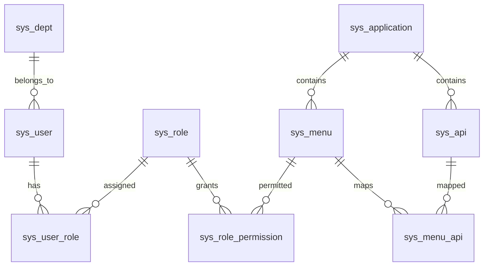

# 数据库设计：11 张表

新空库执行 `db/schema.sql`；JPA 设置 ddl-auto=none，不自动建表。实体统一在 `entity/Domain.java`，每个嵌套实体对应一张表。

| 表 | 作用与主要字段 |
|---|---|
| sys_user | username、real_name、phone、password_hash、employee_no、dept_id、status、source、employment_type、management_scope、session_version |
| sys_dept | dept_code、dept_name、parent_id、status、merged_into_dept_id |
| sys_application | app_code、app_name、app_desc、status |
| sys_menu | app_id、parent_id、menu_code、menu_name、menu_type、path、sort_order、status |
| sys_api | app_id、api_code、api_name、api_path、canonical_path、http_method、status |
| sys_menu_api | menu_id、api_id，组合唯一 |
| sys_role | role_code、role_name、role_desc、status |
| sys_user_role | user_id、role_id，组合唯一，是唯一授权事实 |
| sys_role_permission | role_id、menu_id，组合唯一 |
| sys_data_signature | data_type、data_id、signature，对象类型与 ID 组合唯一 |
| sys_operation_log | user_id、target_user_id、dept_id、operation_type、target_type、target_id、detail、success、created_at |

所有表具有自增 BIGINT id。JSON 中 Long 使用十进制字符串，前端不能转成 Number 再保存。

sys_data_signature 按对象类型与 ID 保护上述关键对象；sys_operation_log 独立保留历史，不加入业务外键链。

source：1 HR、2 临时、3 受控初始化。HR 账号需工号和人员类型，其他账号没有工号/人员类型。账号状态：1 可用、2 暂停、3 离职。用户不物理删除。

management_scope：ALL 或 DEPT_TREE；没有管理权限时该字段不产生任何能力。session_version 用于令牌失效，与编辑并发无关。

menu_type：1 目录，2 菜单权限。API canonical_path 把 `{id}` 等参数名称统一为 `{}`，防止不同参数名重复登记。

用户—角色、角色—菜单、菜单—API 使用外键和唯一约束。树的父节点、同应用关系和无循环由业务校验保证。操作日志不关联业务外键，保留历史 ID 和当时部门快照。

使用 db/schema.sql 建立 11 张表，再通过本地初始化命令导入基础数据。初始化要求各业务表为空。
